# 多代理 AI 輔助 Python 開發系統

### Multi-Agent AI-Assisted Python Development System

讓三個 AI 代理像一個小型開發團隊一樣分工合作：**一個寫程式、一個實際執行、一個負責審查**，
程式碼必須「真的跑得起來」並通過審查，才交給使用者。整套系統在本機運作，不需把程式碼或需求上傳到雲端。

<p>


</p>

> 📄 完整專題報告（61 頁）：[docs/專題報告_多代理AI輔助Python開發系統.pdf](docs/專題報告_多代理AI輔助Python開發系統.pdf)
> 國立虎尾科技大學 資訊工程系 專題製作（114 年 6 月），兩人團隊。

---

## English Summary

A multi-agent system that generates, runs and reviews Python code, built with Microsoft **AutoGen AgentChat** and **locally hosted LLMs** (Ollama). No external API is used, so requirements and source code never leave the machine.

- **Three agents in a round-robin loop:** a *Programmer* writes the code, a *Code Executor* (no LLM) runs it locally and returns stdout, stderr and the exit code, and a *Code Reviewer* reads the result and either suggests fixes or approves. The loop stops when the program runs successfully, the reviewer approves, or 30 messages are reached.
- **Models:** Qwen2.5-7B-Instruct fine-tuned with LoRA (Unsloth) on ~18K Python instructions translated into Traditional Chinese, quantized to GGUF and served by Ollama, alongside `qwen2.5-coder`.
- **Results:** in repeated tests on randomly sampled tasks (30 tasks × 10 runs, 50 tasks × 10 runs), the success rate averaged **77.33%** and **70.8%**; most tasks finished in 3–20 seconds and within 5 rounds.
- **Live web UI:** a Next.js front end posts a task to an API route that spawns the Python process, parses each agent's output and streams it to the browser as NDJSON, so every agent message appears in real time.
- **My role:** Python development and automation, AutoGen agent workflow design, and the code execution and testing mechanism.
- **Known limitation:** the executor runs LLM-generated code directly on the host without a sandbox, so use it only on a trusted machine.

**Quick start:** `ollama pull qwen2.5-coder` → `pip install -r requirements.txt` → `pnpm install` → `pnpm dev` → open http://localhost:3000.

---

## 📌 一頁看懂（給主管的摘要）

| | |
|---|---|
| **要解決的問題** | ChatGPT 這類 AI 寫出來的程式常常「看起來對、實際跑不動」（AI 幻覺）。工程師仍要自己測試、除錯、來回追問，省下的時間被驗證工作吃掉。 |
| **我們的做法** | 不讓一個 AI 單打獨鬥，而是組一個「AI 小團隊」：開發代理寫程式 → 執行代理在電腦上實際跑 → 測試代理看結果、提出修改意見 → 開發代理修正……自動循環，直到程式通過為止。 |
| **成果** | 隨機抽題、每組重複 10 次測試，**平均成功率 70.8%～77.33%**（最高 83.3%）；大多數需求在 **3～20 秒、5 輪對話內**完成。 |
| **特色** | ① 程式一定經過「真實執行」驗證才交付 ② 全部在本機運作，**資料不出公司** ③ 使用自行微調的繁體中文模型 ④ 網頁介面可即時看到每個 AI 在做什麼 |
| **可延伸應用** | 內部自動化腳本產生、資料處理程式草稿、新人程式教學、程式碼自動審查流程 |

### 核心數據

| 指標 | 結果 | 白話說明 |
|------|------|---------|
| 成功率（30 題 × 10 次） | **77.33%**（標準差 7.96） | 每 10 個需求約有 7～8 個能自動產出可執行、通過審查的程式 |
| 成功率（50 題 × 10 次） | **70.8%**（標準差 5.83） | 題目數增加後，結果仍穩定維持 7 成以上 |
| 成功率範圍 | 60% ～ 83.3% | 最差的一次也有 6 成 |
| 單題處理時間 | 平均 43.31 秒，**多數 3～20 秒** | 與一般 AI 聊天工具速度相近；平均值被少數失敗題（拖到上限）拉高 |
| 對話輪數 | 平均 9.63 輪，**多數 ≤ 5 輪** | 多數需求只需 1～2 次「寫 → 跑 → 審」循環 |

---

## 👤 我的負責項目

本專題為兩人團隊合作，我負責的部分如下：

| # | 負責項目 | 具體工作內容 | 對應程式 |
|---|---------|-------------|---------|
| 1 | **Python 程式開發與自動化** | 撰寫多代理系統主程式；以命令列參數接收任務，讓網頁後端能以子行程自動呼叫；設定 UTF-8 輸出解決中文亂碼；串接 Ollama 本地模型（兩種接法：OpenAI 相容 API 與 Ollama 原生 API） | [`autogen_system/autogen_ollama.py`](autogen_system/autogen_ollama.py)<br>[`autogen_system/autogen.py`](autogen_system/autogen.py)<br>[`app/api/autogen/route.ts`](app/api/autogen/route.ts) |
| 2 | **AI Agent 工作流程設計（AutoGen）** | 設計三個代理的角色分工與 System Prompt；選擇 RoundRobin（輪流發言）編排方式；設計三重結束條件（審查通過／程式成功執行／30 則訊息上限），避免 AI 無限迴圈 | [`autogen_system/autogen_ollama.py`](autogen_system/autogen_ollama.py) |
| 3 | **程式執行與測試機制** | 設計「執行代理」：自動擷取 AI 產生的程式碼、寫入檔案並在本機執行，把執行結果（含錯誤訊息）回饋給其他代理；限定只執行開發代理的程式；設計系統測試流程，隨機抽題、重複測試、統計成功率／耗時／輪數 | `CodeExecutorAgent` + `LocalCommandLineCodeExecutor`<br>（見[測試方法](#-系統測試方法與結果)） |

### 從這個專題可以看到的能力

- **把 AI 變成可靠的流程**：不只是「呼叫 AI」，而是設計檢查點與回饋機制，讓 AI 的輸出可被驗證、可被控制。
- **自動化思維**：從需求輸入 → 產生程式 → 執行 → 審查 → 修正，全流程不需人工介入。
- **測試與量化**：用抽樣、重複實驗、統計數據證明系統效果，而不是只靠 Demo。
- **重視資料安全**：整套系統可離線運作，適合不能把資料送上雲端的環境。

---

## 🎬 系統實際畫面

使用者在網頁輸入需求（例如「寫判斷質數的程式碼」），就能看到三個 AI 代理輪流發言，每個代理用不同顏色區分：

| 👨‍💻 程式碼開發代理（藍） | 💻 使用者代理／執行代理（綠） | 🔍 測試代理（紫） |
|:---:|:---:|:---:|
| 根據需求寫 Python 程式 | 在電腦上實際執行程式 | 看執行結果，給修改建議或「同意通過」 |

**範例一：判斷質數** — 開發代理寫出程式 → 執行代理執行得到 `True` → 測試代理回覆「同意通過」，一輪完成。

<p align="center">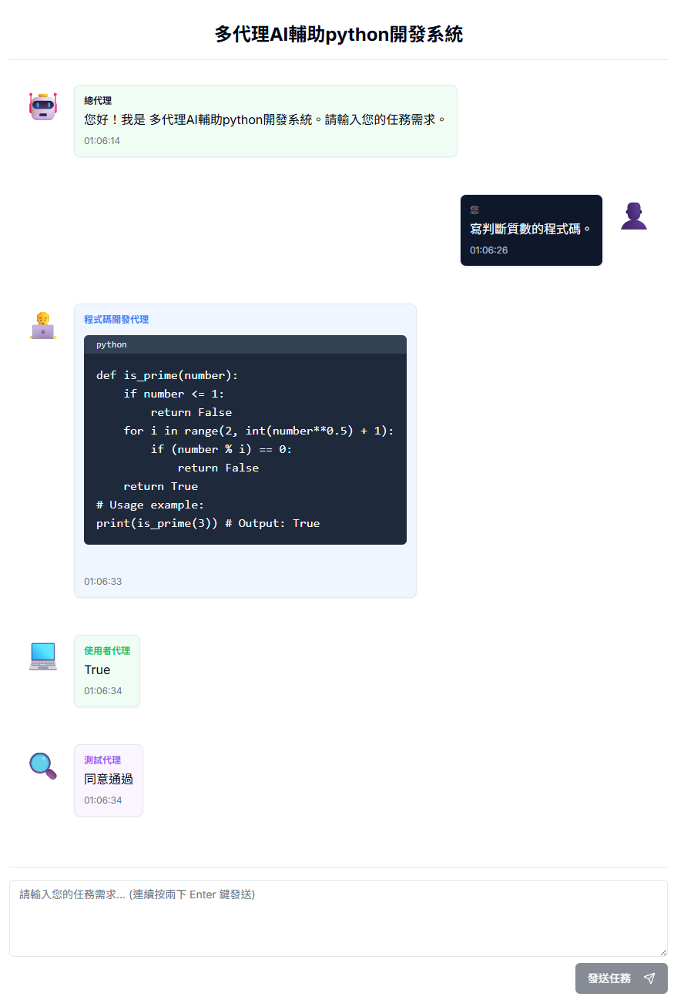</p>

**範例二：較複雜的資料庫程式（自動除錯）** — 第一版程式執行出錯，測試代理指出三個問題（SQL 資料表建立、縮排錯誤、多餘逗號），開發代理修正後重新執行成功，代理之間共輪替 6 次後自動結束。**整個除錯過程不需要人介入。**

<p align="center">
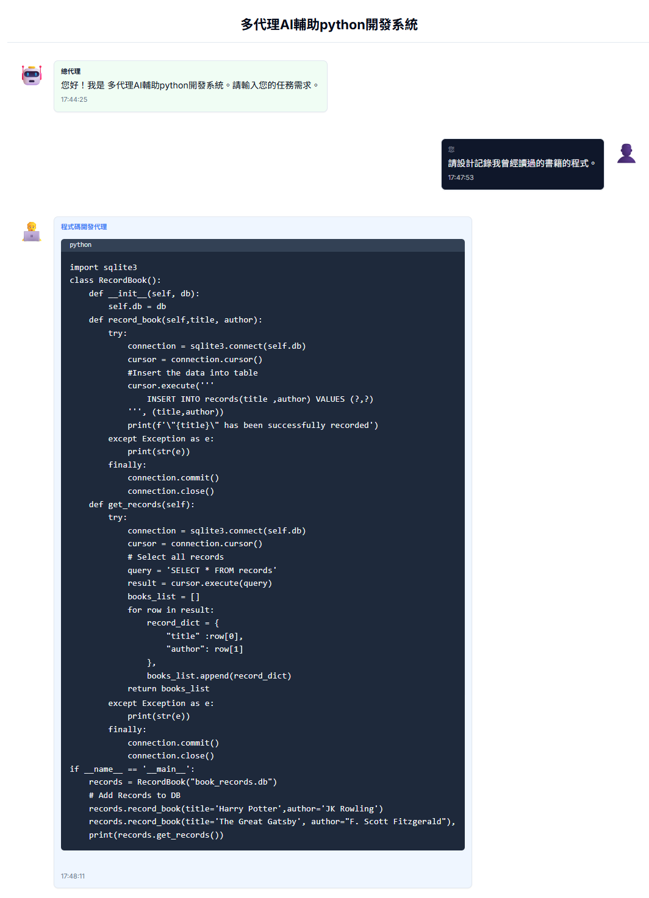
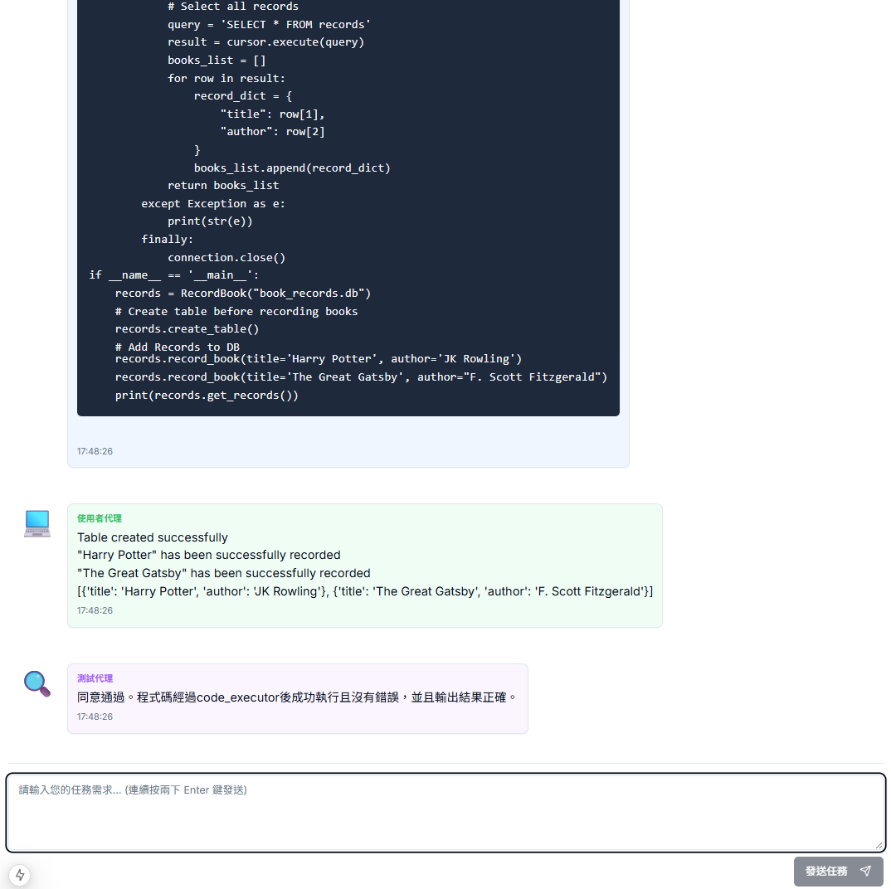
</p>

---

## 🏗️ 系統架構

### 概念圖

<p align="center">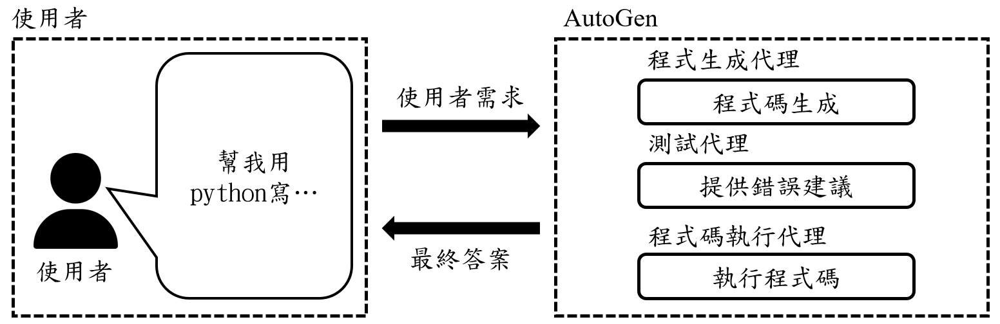</p>

使用者只需要像對同事說話一樣提出需求，AutoGen 裡的三個代理會自己分工完成，最後把**已驗證過**的答案交回。

### 三層架構

<p align="center">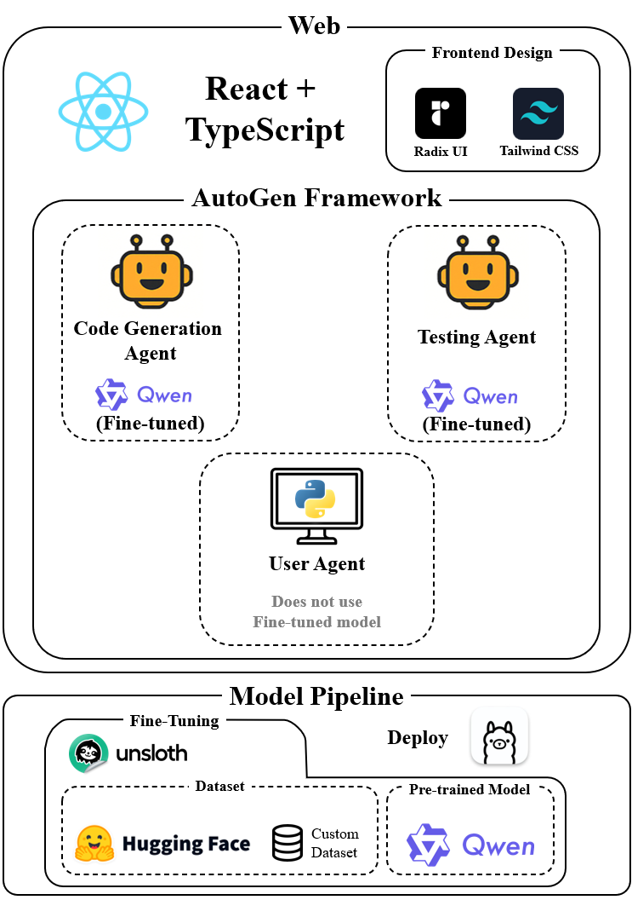</p>

| 層級 | 內容 | 用途 |
|------|------|------|
| **網頁介面** | React + TypeScript（Next.js）、Tailwind CSS、Radix UI | 讓使用者輸入需求，並即時看到代理的對話 |
| **AutoGen 多代理框架** | 程式碼開發代理、測試代理（皆為微調後的 Qwen2.5）、使用者代理（不使用模型，只負責執行程式） | 系統核心：分工、溝通、驗證 |
| **模型訓練與部署** | Hugging Face 資料集 → Unsloth 微調 → GGUF 量化 → Ollama 本地部署 | 提供在本機運作的繁體中文程式模型 |

### 技術版架構圖

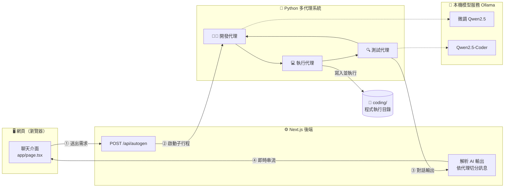

---

## 🔄 運作流程

<p align="center">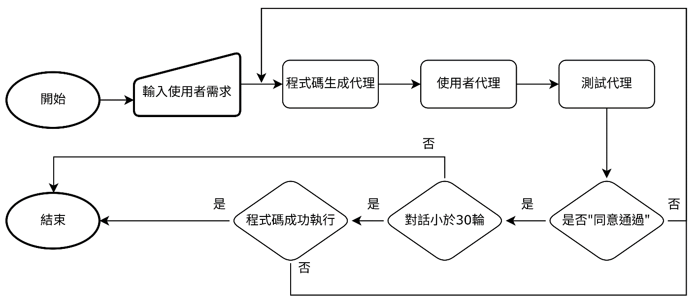</p>

1. 使用者在網頁輸入需求。
2. **開發代理**依需求寫出 Python 程式。
3. **執行代理**把程式存成檔案，在本機實際執行，回報輸出或錯誤訊息。
4. **測試代理**根據程式內容與執行結果判斷：
   - 執行成功且符合需求 → 回覆「**同意通過**」，流程結束；
   - 有錯誤或不符需求 → 提出**具體修改建議**，交回開發代理。
5. 重複 2～4，直到通過。
6. 若超過 **30 輪**仍無法完成，系統自動判定逾時並停止，避免 AI 無止盡地空轉。

> **為什麼要有「執行代理」？** 它不使用 AI，只是單純把程式跑一遍。這讓「程式能不能動」的判斷來自電腦的真實結果，而不是 AI 自己說「應該可以」——這是降低 AI 幻覺最關鍵的設計。

---

## 📊 系統測試方法與結果

### 測試方法

<p align="center">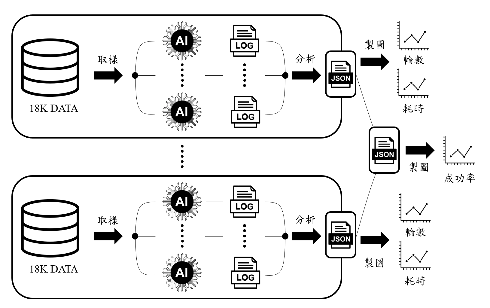</p>

1. 從 18K 筆中文程式需求資料集中，**隨機抽出 30 題**（另一組抽 50 題）；
2. 每題交給系統自動處理，**完整記錄每一次對話過程**（LOG）；
3. 逐一分析紀錄檔，產生 JSON 統計檔（耗時、對話輪數、成功與否）；
4. 整組題目**重複測試 10 次**，計算平均成功率與標準差，確認結果穩定而非碰運氣。

### 結果

| 每題執行時間 | 每題對話輪數 |
|:---:|:---:|
| 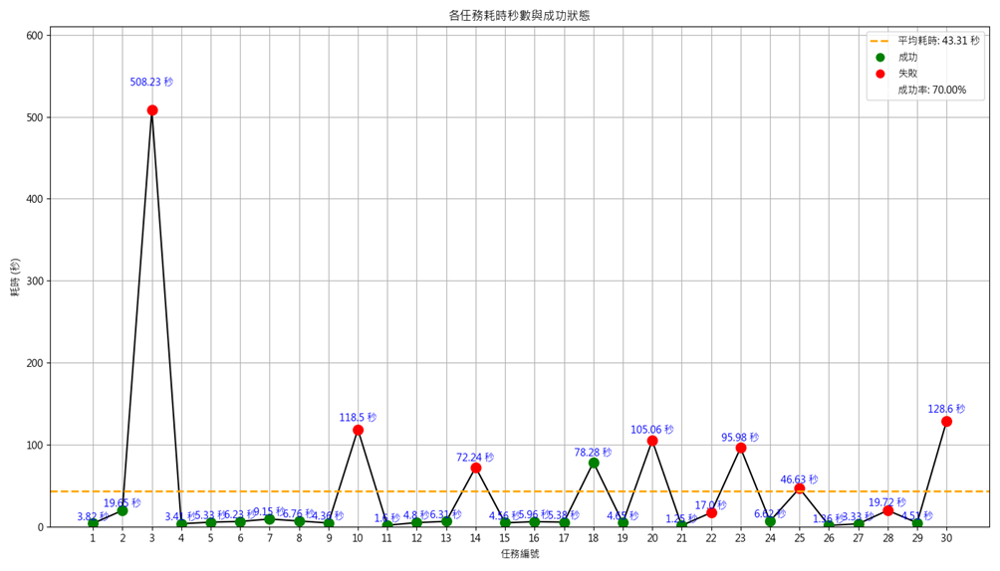 | 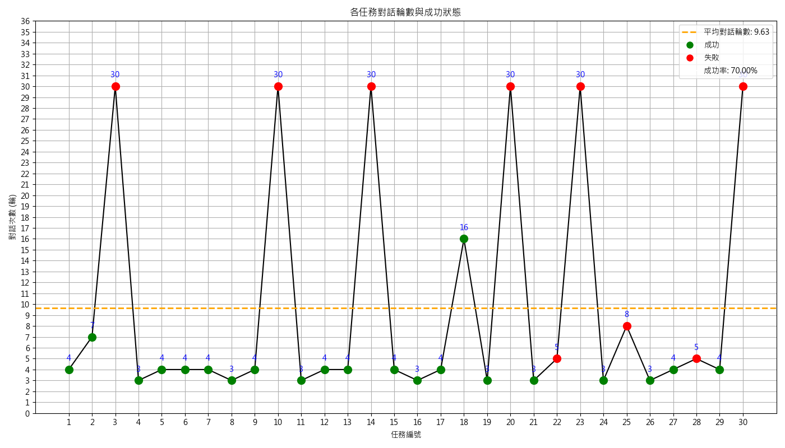 |
| 平均 43.31 秒；多數 3～20 秒。超過 40 秒的多為最終失敗的題目。 | 平均 9.63 輪；多數 5 輪內完成。超過 10 輪的多以失敗結束（常觸及 30 輪上限）。 |

| 30 題 × 10 次 成功率 | 50 題 × 10 次 成功率 |
|:---:|:---:|
| 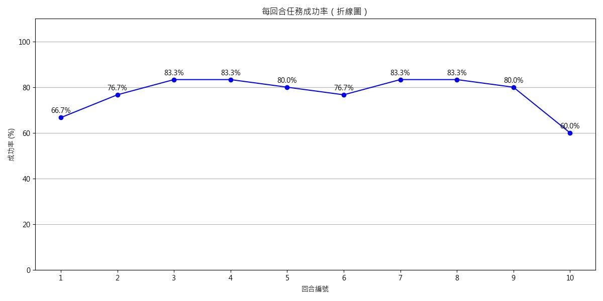 | 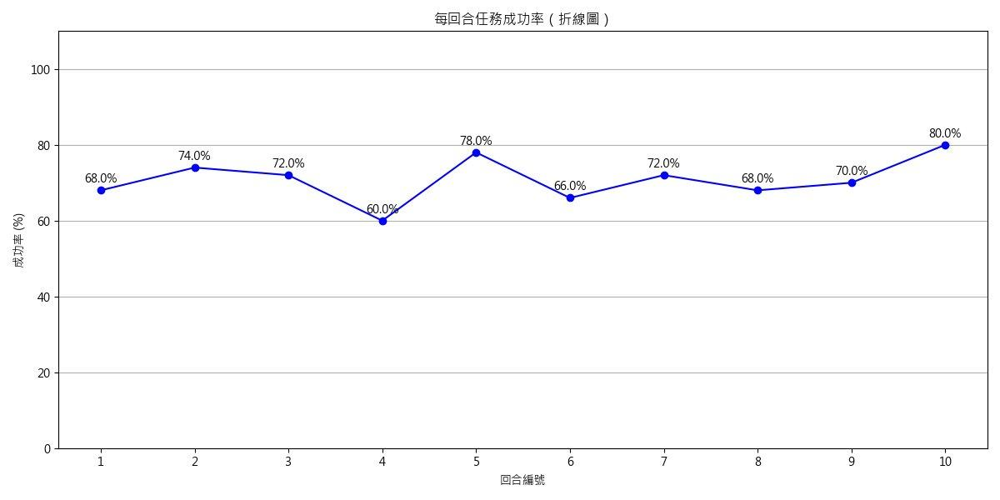 |
| 平均 **77.33%**，標準差 7.96 | 平均 **70.8%**，標準差 5.83 |

**解讀：**
- 系統能**自動抓出並修正無法執行的程式碼**，七成以上的需求可在無人介入下產出可執行程式。
- 成功的題目通常很快（數秒～20 秒、5 輪內）；失敗的題目會拖到上限，因此「失敗」也能被系統明確標示出來，而不是交出一份錯的程式。

---

## ⚙️ 技術細節

<details>
<summary><b>1. 三個代理的設計</b>（點擊展開）</summary>

| 代理 | AutoGen 類別 | 使用模型 | 介面名稱 | 職責 |
|------|------|------|------|------|
| `programmer` | `AssistantAgent` | `my_qwen2.5_newQ8_py`（Qwen2.5-7B-Instruct + LoRA 微調，Q8 量化） | 👨‍💻 程式碼開發代理 | 依需求撰寫程式、依建議修正 |
| `code_executor` | `CodeExecutorAgent` | 無（不使用 LLM） | 💻 使用者代理 | 擷取程式碼、寫檔、本機執行、回報結果 |
| `code_reviewer` | `AssistantAgent` | `qwen2.5-coder` | 🔍 測試代理 | 檢查語法／邏輯／PEP 8，依執行結果判斷是否通過 |

**開發代理 System Prompt 重點**

| 規則 | 目的 |
|------|------|
| 符合 PEP 8、清晰可維護 | 程式品質 |
| 使用 Markdown 區塊並標注語言 | 讓執行代理能正確擷取程式碼 |
| 只輸出**一份完整**程式碼 | 避免多個片段造成執行混亂 |
| 依 `code_reviewer` 建議修改並重新輸出完整程式 | 每一版都能獨立執行 |
| **不使用 `input()`** | 自動執行時沒有人可以輸入，否則程式會卡住 |
| 包含完整單元測試 | 讓「執行成功」本身就代表結果正確 |
| 回答與註解使用繁體中文 | 在地化 |

**測試代理 System Prompt 重點**

1. 檢查程式碼語法與邏輯錯誤；
2. 提供具體的修改建議；
3. 確認符合 PEP 8；
4. 只有在程式經執行代理成功執行且無錯誤時，才回覆「同意通過」。

</details>

<details>
<summary><b>2. AutoGen 編排方式：為什麼選 RoundRobin</b></summary>

AutoGen 提供多種多代理編排方式：

| 方式 | 說明 | 本專題評估 |
|------|------|-----------|
| **RoundRobinGroupChat** | 依固定順序輪流發言 | ✅ 採用。流程與「寫 → 跑 → 審」一致、行為可預測、每輪不需額外的 AI 呼叫 |
| SelectorGroupChat | 由 LLM 動態決定下一位發言者 | 本地小模型容易選錯角色，且每輪多一次推論成本 |
| Swarm | 代理之間主動交接任務（handoff） | 較適合客服等分流情境 |
| GraphFlow | 以有向圖定義流程（分支、並行、迴圈） | 本流程為單純循環，不需此複雜度 |
| MagenticOneGroupChat | 協調者規劃任務並追蹤進度 | 適合開放式、跨領域任務 |

發言順序固定為：**programmer → code_executor → code_reviewer → programmer → …**

</details>

<details>
<summary><b>3. 結束條件設計（防止 AI 無限迴圈）</b></summary>

```python
text_termination = (
    TextMentionTermination("The POSIX exit code was: 0.")   # 程式成功執行
    | MaxMessageTermination(30)                              # 安全上限 30 則訊息
    | TextMentionTermination("同意通過")                      # 測試代理審查通過
)
```

| 條件 | 用途 |
|------|------|
| 程式成功執行（exit code 0） | 以客觀結果提早結束，節省本地模型推論時間 |
| 測試代理回覆「同意通過」 | 由審查角色判斷品質達標 |
| 30 則訊息上限 | 保證系統一定會結束，失敗也會被明確標示 |

由於要求開發代理在程式中加入單元測試，若邏輯錯誤導致測試失敗，exit code 就不會是 0，因此「執行成功即結束」仍具正確性保證。

</details>

<details>
<summary><b>4. 程式執行機制</b></summary>

```python
code_executor = CodeExecutorAgent(
    name="code_executor",
    code_executor=LocalCommandLineCodeExecutor(work_dir="coding"),
    sources="programmer",   # 只執行開發代理產生的程式碼
)
```

1. 從開發代理的訊息中擷取 ```` ```python ```` 程式碼區塊；
2. 寫入 `coding/tmp_code_<雜湊值>.py`；
3. 啟動新的子行程執行，蒐集 stdout、stderr、exit code；
4. 把結果當作一則新訊息放回對話，讓測試代理與開發代理看到。

`sources="programmer"` 確保不會誤執行測試代理在建議中引用的程式片段。

</details>

<details>
<summary><b>5. 模型微調流程</b></summary>

<p align="center">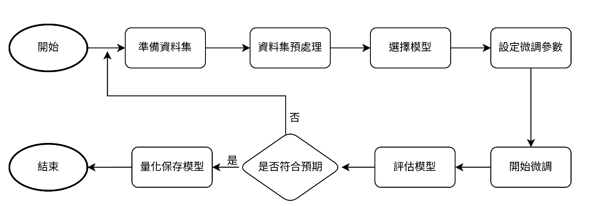</p>

| 項目 | 內容 |
|------|------|
| 基礎模型 | Qwen2.5-7B-Instruct（初期試過 LLaMA，但中文理解不穩定，改用 Qwen2.5） |
| 資料集 | Hugging Face `iamtarun/python_code_instructions_120k_alpaca`，從約 12 萬筆精選約 **1.8 萬筆** |
| 資料處理 | Google 翻譯 + 人工審查翻成繁體中文 → 由 Alpaca 格式轉為 ChatML 對話格式 |
| 微調方法 | LoRA（Unsloth），於 Google Colab 訓練 |
| 訓練參數 | batch size 2、100 steps、learning rate 2e-4、8-bit 優化器、視硬體使用 bfloat16 |
| 部署 | 量化為 GGUF → 以 Ollama Modelfile 載入（temperature 1.5、min_p 0.1、ChatML 對話樣板） |
| 微調效果 | 微調前常以簡體中文回答、一次產生多份內容；微調後**全部以繁體中文回答，且輸出單一、精簡、風格一致的解答** |

</details>

<details>
<summary><b>6. 網頁即時顯示：前後端訊息傳遞</b></summary>

<p align="center">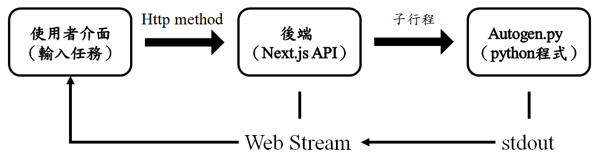</p>

1. 前端以 HTTP POST 將需求送到 Next.js API（`/api/autogen`）；
2. 後端以**子行程**啟動 `python autogen_ollama.py "<需求>"`，並設定 `PYTHONIOENCODING=utf-8` 避免中文亂碼；
3. AutoGen 的輸出會以 `---------- programmer ----------` 等標記區分發言者，後端逐行讀取 stdout，遇到新標記就把前一段打包成 JSON：
   ```json
   {"agent": "programmer", "content": "```python\n...\n```"}
   ```
4. 以 Web Stream（NDJSON 串流）一段段推送給前端；
5. 前端依 `agent` 欄位決定顯示的圖示、名稱與底色，即時加入畫面。

</details>

<details>
<summary><b>7. 專案結構</b></summary>

```text
MutiAgent_system/
├── app/
│   ├── api/autogen/route.ts     # 啟動 Python 多代理系統並串流回傳
│   ├── api/chat/route.ts        # 範例／佔位 API
│   ├── layout.tsx
│   └── page.tsx                 # 聊天介面
├── autogen_system/
│   ├── autogen_ollama.py        # 主要版本：Ollama 原生客戶端（網頁使用此版本）
│   └── autogen.py               # 另一版本：OpenAI 相容 API 接 Ollama
├── components/ui/               # shadcn/ui 元件
├── docs/
│   ├── images/                  # README 圖片
│   └── 專題報告_多代理AI輔助Python開發系統.pdf
├── hooks/  lib/  public/  styles/
├── requirements.txt             # Python 套件
└── package.json                 # Node.js 套件
```

</details>

---

## 🚀 安裝與執行

**環境需求：** Node.js 18+、Python 3.10+、[Ollama](https://ollama.com/)；建議有 GPU（8 GB VRAM 以上）。

1. 下載模型（若沒有自訂微調模型，可把程式中的 `my_qwen2.5_newQ8_py:latest` 改成 `qwen2.5-coder:latest`）：

```bash
ollama pull qwen2.5-coder
```

2. 安裝 Python 套件：

```bash
pip install -r requirements.txt
```

3. 安裝網頁套件：

```bash
pnpm install
```

4. 啟動（需先確認 Ollama 已在 `localhost:11434` 運作）：

```bash
pnpm dev
```

5. 開啟 <http://localhost:3000>，輸入需求後**連按兩下 Enter** 或按「發送任務」。

也可以只用命令列執行多代理系統：

```bash
python autogen_system/autogen_ollama.py "寫一個判斷質數的函式，並附上單元測試"
```

---

## 🔍 限制與後續改進方向

| 現況限制 | 改進方向 |
|---------|---------|
| 程式直接在本機執行，沒有隔離 | 改用 Docker 容器執行，加上逾時與資源限制，才適合多人共用環境 |
| 7B 本地模型在複雜任務（多檔案、大型套件）能力有限，成功率約 7 成 | 換用更大模型、擴充微調資料（例如用本系統成功修正的對話紀錄再訓練） |
| 目前只支援 Python | 擴充 JavaScript、SQL 等語言的執行器 |
| 每次需求都重新啟動 Python 行程，無法延續上一題的對話 | 改為常駐服務（FastAPI / WebSocket），支援多輪追問與人工介入 |
| 後端以文字標記解析 AI 輸出，框架更新時可能失效 | 改由 Python 端直接輸出結構化 JSON |

---

## ✅ 結論

1. **多代理分工確實能檢查並修正無法執行的程式碼**：把「寫、跑、審」拆給不同角色，並以真實執行結果作為依據，七成以上的需求可自動產出可執行程式。
2. **速度與一般 AI 工具相當**：多數需求在 3～20 秒、5 輪內完成。
3. **可完全本地化**：以開源模型 + LoRA 微調 + Ollama，在一般硬體即可運作，資料不需離開本機。
4. **流程透明**：網頁即時顯示每個代理的發言，使用者能理解 AI 為什麼這樣修改，提升信任度。

---

## 📖 名詞小辭典

| 名詞 | 白話解釋 |
|------|---------|
| AI 代理（Agent） | 被賦予特定角色與任務的 AI，例如「負責寫程式的 AI」 |
| 多代理系統 | 多個 AI 代理分工合作，像一個團隊 |
| AutoGen | 微軟開源的多代理框架，用來建立與協調多個 AI 代理 |
| LLM（大型語言模型） | ChatGPT 背後那類 AI 模型；本專題使用阿里巴巴開源的 Qwen2.5 |
| 幻覺（Hallucination） | AI 一本正經地給出錯誤答案，例如寫出跑不動的程式 |
| 微調（Fine-tuning）／LoRA | 用自己的資料再訓練模型，讓它更符合需求；LoRA 是省資源的微調方法 |
| Ollama | 在自己電腦上執行 AI 模型的工具，不需連網到雲端 |
| 量化（GGUF） | 把模型壓縮變小，讓一般電腦也跑得動 |

---

## 參考文獻

1. Wu, Q., et al. (2023). *AutoGen: Enabling Next-Gen LLM Applications via Multi-Agent Conversation*. arXiv:2308.08155.
2. Yang, Q. A., et al. (2024). *Qwen2.5 Technical Report*. arXiv:2412.15115.
3. Hu, E. J., et al. (2021). *LoRA: Low-Rank Adaptation of Large Language Models*. arXiv:2106.09685.
4. Huang, D., et al. (2023). *AgentCoder: Multi-Agent-based Code Generation with Iterative Testing and Optimisation*. arXiv:2312.13010.
5. Guo, T., et al. (2024). *Large Language Model based Multi-Agents: A Survey of Progress and Challenges*. arXiv:2402.01680.
6. Xu, Z., Jain, S., & Kankanhalli, M. (2024). *Hallucination is Inevitable: An Innate Limitation of Large Language Models*. arXiv:2401.11817.
7. Vaswani, A., et al. (2017). *Attention Is All You Need*. arXiv:1706.03762.
8. iamtarun. *python_code_instructions_120k_alpaca*. Hugging Face Datasets.
9. Microsoft AutoGen Documentation: <https://microsoft.github.io/autogen/>
10. Ollama: <https://ollama.com/>　Unsloth: <https://github.com/unslothai/unsloth>
