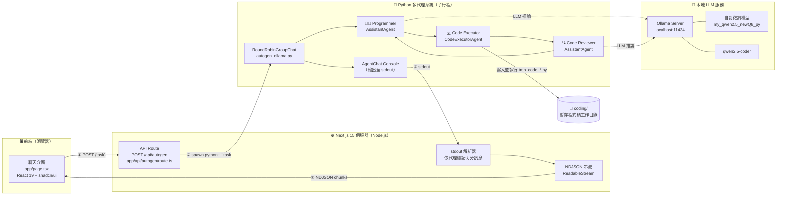
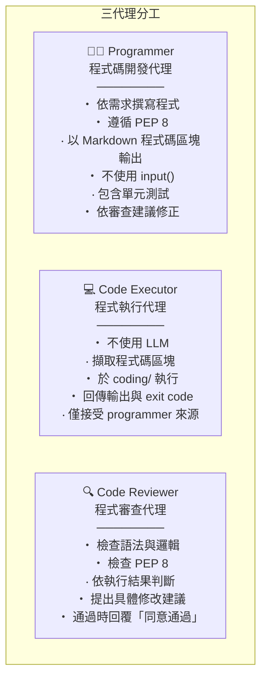
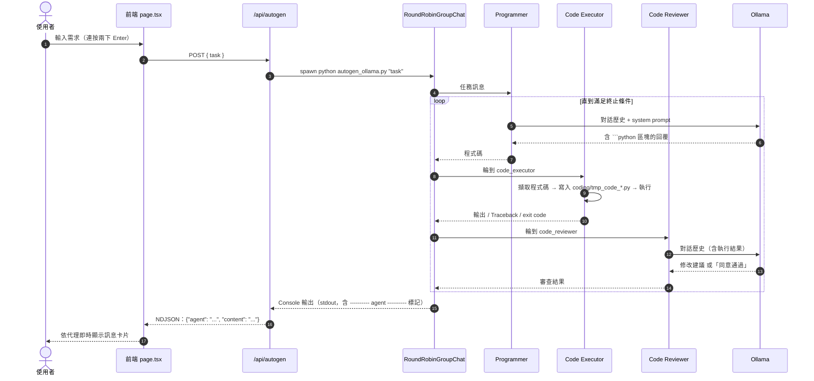
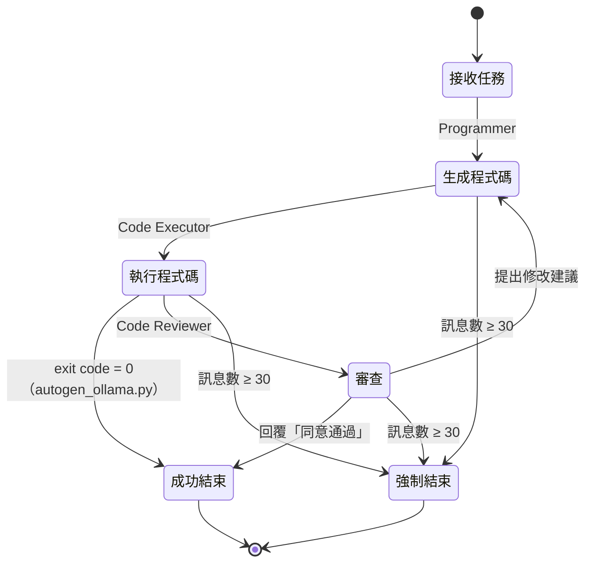

# 多代理 AI 輔助 Python 開發系統

### Multi-Agent AI-Assisted Python Development System based on AutoGen and Locally Deployed LLMs

<p>


</p>

---

## 目錄

1. [摘要](#摘要)
2. [緒論](#一緒論)
   - 1.1 研究背景
   - 1.2 研究動機
   - 1.3 研究目的
   - 1.4 研究貢獻
3. [文獻探討](#二文獻探討)
4. [系統架構](#三系統架構)
   - 3.1 整體架構圖
   - 3.2 分層說明
   - 3.3 代理角色設計
   - 3.4 互動時序圖
   - 3.5 狀態流程圖
5. [研究方法](#四研究方法)
   - 4.1 多代理協作框架
   - 4.2 回合制群組對話（Round-Robin Group Chat）
   - 4.3 提示工程（Prompt Engineering）
   - 4.4 執行回饋迴圈（Execution-Feedback Loop）
   - 4.5 終止條件設計
   - 4.6 本地模型部署與異質模型配置
   - 4.7 串流輸出解析協定
   - 4.8 前端互動設計
6. [系統實作](#五系統實作)
7. [安裝與執行](#六安裝與執行)
8. [實驗與觀察](#七實驗與觀察)
9. [討論與限制](#八討論與限制)
10. [結論與未來展望](#九結論與未來展望)
11. [參考文獻](#參考文獻)

---

## 摘要

大型語言模型（Large Language Models, LLMs）在程式碼生成任務上已有顯著進展，但單一模型「一次生成」（single-pass generation）的方式，常產生語法錯誤、邏輯錯誤或無法實際執行的程式碼，且使用者難以掌握模型修正的過程。此外，主流商用 LLM 服務需將原始碼與需求傳送至雲端，對於重視資料隱私或須離線作業的場景並不友善。

本研究設計並實作一套**多代理 AI 輔助 Python 開發系統**。系統以 Microsoft **AutoGen AgentChat** 框架為核心，建構三個角色分工明確的代理：

- **程式開發代理（Programmer Agent）**：依需求撰寫 Python 程式碼；
- **程式執行代理（Code Executor Agent）**：在本機實際執行程式碼並回傳結果；
- **程式審查代理（Code Reviewer Agent）**：依執行結果與程式內容提供修改建議，並判定是否通過。

三個代理以**回合制群組對話（Round-Robin Group Chat）**形成「生成 → 執行 → 審查 → 修正」的閉環迭代流程，直到審查代理回覆「同意通過」、程式成功執行，或達到最大訊息數上限為止。所有語言模型皆透過 **Ollama** 於本機部署（Qwen2.5-Coder 及自行微調之量化模型），不依賴任何雲端 API，以兼顧隱私與成本。

前端採用 **Next.js 15 + React 19 + Tailwind CSS + shadcn/ui** 實作聊天式介面，後端 API Route 以子行程（child process）啟動 Python 多代理系統，即時解析其標準輸出並以 **NDJSON 串流**推送至瀏覽器，讓使用者可即時觀察各代理的對話與協作過程。

**關鍵字：** 多代理系統、大型語言模型、程式碼生成、AutoGen、Ollama、本地部署、執行回饋、Next.js

---

## 一、緒論

### 1.1 研究背景

自 Codex、Code Llama、StarCoder、Qwen2.5-Coder 等程式碼專用模型問世以來，以自然語言描述需求、由 LLM 自動產生程式碼已成為軟體開發的重要輔助手段。然而相關研究與實務經驗指出，LLM 生成程式碼仍存在以下問題：

1. **幻覺（Hallucination）**：呼叫不存在的函式庫或 API；
2. **不可執行**：語法錯誤、缺少 import、依賴使用者輸入（`input()`）而無法自動驗證；
3. **邏輯錯誤**：程式可執行但輸出與預期不符；
4. **缺乏自我驗證**：單次生成的模型無法得知程式實際執行結果。

人類軟體團隊則以「開發者撰寫 → 執行測試 → 同儕審查（Code Review）→ 修正」的流程來確保品質。若能讓多個 LLM 代理模擬此分工，並引入**真實執行環境的回饋**，有機會大幅提升生成程式碼的正確率。

### 1.2 研究動機

- **單一代理的局限**：同一個模型同時負責撰寫與檢查，容易「自我確認偏誤」，對自己的錯誤視而不見。
- **執行回饋的價值**：直譯器的錯誤訊息（Traceback）是最客觀的訊號，比單純由模型「想像」程式是否正確更可靠。
- **隱私與成本**：企業或學術單位的程式碼往往不便上傳雲端；本地部署的開源模型可完全離線運作，且無按次計費成本。
- **可觀察性**：多數程式碼生成工具僅給出最終結果，使用者無法理解中間的推理與修正過程，不利於學習與除錯。

### 1.3 研究目的

本研究目的如下：

1. 設計一套基於多代理協作的 Python 程式碼自動生成與驗證架構；
2. 將「程式實際執行結果」納入代理間的對話上下文，形成閉環的自我修正機制；
3. 以本地部署之開源 LLM 實現完全離線的系統，並探討以不同模型擔任不同角色（異質模型配置）的可行性；
4. 開發即時串流的 Web 介面，使使用者能以繁體中文下達需求並即時觀察代理協作過程。

### 1.4 研究貢獻

| # | 貢獻 | 說明 |
|---|------|------|
| 1 | 三角色多代理架構 | 將開發、執行、審查職責解耦，模擬真實軟體團隊分工 |
| 2 | 執行回饋閉環 | 以 `LocalCommandLineCodeExecutor` 真實執行程式，錯誤訊息回饋給代理修正 |
| 3 | 多重終止條件 | 結合語意終止（「同意通過」）、執行成功終止（exit code 0）與安全上限（30 則訊息） |
| 4 | 完全本地化 | 所有模型經 Ollama 本機推論，無須雲端 API 金鑰 |
| 5 | 異質模型配置 | 開發與審查使用不同模型（含自行微調之量化模型），降低同質模型的盲點 |
| 6 | 串流可視化介面 | Python stdout → Node.js 解析 → NDJSON 串流 → React 即時呈現各代理訊息 |
| 7 | 繁體中文在地化 | 系統提示詞、介面與回覆皆以繁體中文設計 |

---

## 二、文獻探討

### 2.1 大型語言模型與程式碼生成

Chen et al.（2021）提出 Codex 並建立 HumanEval 基準，證明 LLM 可依函式說明生成正確程式碼，並以 pass@k 作為評估指標。後續 Code Llama（Rozière et al., 2023）、Qwen2.5-Coder（Hui et al., 2024）等開源模型持續提升程式碼能力，使在消費級硬體上本地部署程式碼模型成為可能。

### 2.2 自我修正與執行回饋

Self-Refine（Madaan et al., 2023）讓模型對自身輸出提出回饋並迭代改進；Reflexion（Shinn et al., 2023）以語言化的反思作為強化訊號；Self-Debugging（Chen et al., 2023）則指出結合**程式執行結果**的回饋，能明顯提升程式碼生成正確率。本研究承襲此一思路，並以獨立的執行代理與審查代理實作。

### 2.3 多代理協作框架

- **AutoGen**（Wu et al., 2023）：由 Microsoft 提出，以「可對話代理（Conversable Agents）」為核心，支援多代理對話、工具使用與程式碼執行。本研究使用其新版 **AgentChat 0.4** API（`AssistantAgent`、`CodeExecutorAgent`、`RoundRobinGroupChat`）。
- **MetaGPT**（Hong et al., 2023）：以標準作業程序（SOP）將產品經理、架構師、工程師等角色串接。
- **ChatDev**（Qian et al., 2023）：以「聊天鏈」模擬軟體公司的瀑布式開發流程。
- **AgentCoder**（Huang et al., 2023）：以程式設計師、測試設計者、測試執行者三代理協作生成程式碼。

本研究與上述工作的差異在於：**著重輕量化（僅三個代理）、完全本地化部署、繁體中文情境，以及提供即時可視化的 Web 介面**。

### 2.4 本地 LLM 部署

Ollama 提供以 llama.cpp 為基礎的本地推論服務，支援 GGUF 量化格式（如 Q4_K_M、Q8_0），並提供 OpenAI 相容 API（`/v1`）。Unsloth 則是一套高效率的 LoRA / QLoRA 微調工具，可將微調後模型匯出為 GGUF 格式供 Ollama 載入。

---

## 三、系統架構

### 3.1 整體架構圖



### 3.2 分層說明

| 層級 | 元件 | 技術 | 職責 |
|------|------|------|------|
| 表現層（Presentation） | `app/page.tsx` | Next.js App Router、React 19、Tailwind CSS、shadcn/ui（Radix UI） | 接收使用者需求、即時顯示各代理訊息、渲染程式碼區塊 |
| 介接層（Gateway） | `app/api/autogen/route.ts` | Next.js Route Handler、Node.js `child_process`、Web Streams API | 啟動 Python 子行程、解析 stdout、轉為 NDJSON 串流回傳 |
| 協作層（Orchestration） | `autogen_system/autogen_ollama.py`、`autogen.py` | AutoGen AgentChat 0.4 | 定義代理、團隊與終止條件，驅動多代理對話 |
| 執行層（Execution） | `LocalCommandLineCodeExecutor` | 本機 Python 直譯器 | 擷取 Markdown 程式碼區塊、寫入 `coding/` 並執行，回傳 stdout / stderr / exit code |
| 模型層（Model） | Ollama | llama.cpp、GGUF 量化模型 | 提供本地 LLM 推論服務 |

### 3.3 代理角色設計



| 代理 | AutoGen 類別 | 使用模型（`autogen_ollama.py`） | 使用模型（`autogen.py`） | 介面顯示名稱 |
|------|------|------|------|------|
| `programmer` | `AssistantAgent` | `my_qwen2.5_newQ8_py:latest`（自訂微調，Q8 量化） | `qwen2.5-coder:latest` | 👨‍💻 程式碼開發代理 |
| `code_executor` | `CodeExecutorAgent` | — （不使用 LLM） | — | 💻 使用者代理 |
| `code_reviewer` | `AssistantAgent` | `qwen2.5-coder:latest` | `my_unsloth.Q4_K_M:latest`（Unsloth 微調，Q4_K_M 量化） | 🔍 測試代理 |

> **設計理念：** 執行代理刻意**不使用 LLM**，以確保「程式是否可執行」這項判斷來自真實直譯器而非模型推測；開發與審查則使用**不同模型**，避免同一模型對自身錯誤的系統性盲點。

### 3.4 互動時序圖



### 3.5 狀態流程圖



---

## 四、研究方法

### 4.1 多代理協作框架

本系統將程式碼生成問題形式化為多代理的序列決策過程。設使用者需求為 $q$，代理集合為

$$
\mathcal{A} = \{ a_P, a_E, a_R \}
$$

分別代表開發、執行與審查代理。對話歷史（共享上下文）記為

$$
H_t = \langle m_0 = q,\ m_1,\ m_2,\ \dots,\ m_t \rangle
$$

在第 $t$ 步，被選中的代理 $a^{(t)}$ 根據完整歷史產生下一則訊息：

$$
m_{t+1} = a^{(t)}(H_t)
$$

其中：

- $a_P(H_t) = \text{LLM}_P(\text{sys}_P \oplus H_t)$，輸出含程式碼 $c$ 的訊息；
- $a_E(H_t) = \text{Exec}(\text{extract}(m_t))$，回傳 $(\text{stdout}, \text{stderr}, \text{exitcode})$；
- $a_R(H_t) = \text{LLM}_R(\text{sys}_R \oplus H_t)$，輸出修改建議或「同意通過」。

由於每個代理都能看到**完整的共享歷史**，審查代理可同時參考原始需求、程式碼與實際執行結果；開發代理在下一輪也能看到錯誤訊息與審查建議，據以修正。

### 4.2 回合制群組對話（Round-Robin Group Chat）

AutoGen 提供多種團隊編排策略，本研究採用 `RoundRobinGroupChat`，發言順序固定為：

$$
a^{(t)} = \mathcal{A}\big[\, t \bmod 3 \,\big],\quad \mathcal{A} = [a_P,\ a_E,\ a_R]
$$

亦即 **Programmer → Executor → Reviewer → Programmer → …**。選擇固定順序而非 `SelectorGroupChat`（由 LLM 動態決定下一位發言者）的理由：

1. **確定性**：流程與真實「撰寫 → 測試 → 審查」一致，行為可預測、易於除錯；
2. **低成本**：省去每輪額外一次「選擇發言者」的 LLM 呼叫，對本地小模型尤其重要；
3. **穩健性**：小型本地模型在動態選擇發言者時容易選錯角色，固定順序可避免此問題。

> 程式碼中保留了 `SelectorGroupChat` 的註解，作為未來比較實驗的選項。

### 4.3 提示工程（Prompt Engineering）

各代理的行為主要由 **system message** 約束。以下為 `autogen_ollama.py` 中的設計要點：

**Programmer（開發代理）**

| 約束 | 目的 |
|------|------|
| 符合 PEP 8 規範、清晰可維護 | 提升程式品質與可讀性 |
| 使用 Markdown 區塊並標注語言 | 讓 `CodeExecutorAgent` 能正確擷取程式碼 |
| 只輸出**一個完整**程式碼 | 避免多個片段造成執行混亂 |
| 依 `code_reviewer` 建議修改並重新輸出完整程式碼 | 確保每輪都是可獨立執行的版本 |
| 不使用 `input()` | 自動執行環境無法提供互動輸入，否則會卡住或失敗 |
| 包含完整單元測試 | 讓執行結果本身即成為正確性的驗證 |
| 回答與註解使用繁體中文 | 在地化 |

**Code Reviewer（審查代理）**

| 約束 | 目的 |
|------|------|
| 定位為「語法分析器」，檢查語法與邏輯錯誤 | 聚焦於可驗證的問題 |
| 依步驟：檢查錯誤 → 提出具體建議 → 檢查 PEP 8 | 結構化的思考流程（類 Chain-of-Thought） |
| 程式成功執行且無錯誤才回覆「同意通過」 | 將終止判斷綁定於客觀執行結果 |
| （`autogen.py`）不生成程式碼，只給建議 | 角色分離，避免審查者「代寫」造成責任混淆 |

### 4.4 執行回饋迴圈（Execution-Feedback Loop）

`CodeExecutorAgent` 搭配 `LocalCommandLineCodeExecutor(work_dir="coding")`：

1. 從上一則訊息中以正規表示式擷取 ```` ```python ... ``` ```` 區塊；
2. 以內容雜湊命名寫入 `coding/tmp_code_<sha256>.py`；
3. 以本機 Python 直譯器執行，蒐集 stdout、stderr 與 exit code；
4. 將結果作為新訊息加入共享歷史。

在 `autogen_ollama.py` 中設定 `sources="programmer"`，使執行代理**只執行開發代理產生的程式碼**，避免誤執行審查代理在建議中引用的程式片段。

此設計使系統的修正行為由**真實執行訊號**驅動，概念上近似 Self-Debugging，但將「除錯」責任分散到獨立的審查代理。

### 4.5 終止條件設計

AutoGen 的終止條件可用 `|`（OR）組合。本研究兩個版本的設定如下：

| 版本 | 終止條件 | 說明 |
|------|------|------|
| `autogen.py` | `TextMentionTermination("同意通過") \| MaxMessageTermination(30)` | 由審查代理語意判定是否通過 |
| `autogen_ollama.py` | `TextMentionTermination("The POSIX exit code was: 0.") \| MaxMessageTermination(30) \| TextMentionTermination("同意通過")` | 程式**一經成功執行即結束**，或審查通過，或達上限 |

形式化而言，對話在第 $T$ 步結束，其中

$$
T = \min\Big\{\, t \;\Big|\; \texttt{"同意通過"} \in m_t \;\lor\; \texttt{exit}(m_t) = 0 \;\lor\; t \ge 30 \Big\}
$$

- **語意終止**：讓審查代理以自然語言決定品質是否達標；
- **執行成功終止**：以客觀訊號提早結束，大幅減少本地小模型的推論輪數與等待時間；
- **安全上限**：避免模型陷入無限修正或來回爭論，確保系統必定結束。

> **取捨：** exit code 為 0 僅代表「程式未拋出例外」，不保證輸出正確；因此要求開發代理在程式中加入單元測試（`assert` / `unittest`），讓「測試失敗」也會反映為非零 exit code，使提早終止仍具正確性保證。

### 4.6 本地模型部署與異質模型配置

系統提供兩種模型接入方式：

| 方式 | 檔案 | 客戶端 | 端點 |
|------|------|------|------|
| OpenAI 相容 API | `autogen.py` | `OpenAIChatCompletionClient` | `http://localhost:11434/v1`（`api_key="ollama"` 為佔位值） |
| Ollama 原生 API | `autogen_ollama.py` | `OllamaChatCompletionClient` | Ollama 預設 `localhost:11434` |

使用的模型：

- **qwen2.5-coder**：阿里巴巴 Qwen 團隊之開源程式碼模型；
- **my_qwen2.5_newQ8_py**：以 Qwen2.5 為基底、針對 Python 程式碼任務自行微調之模型，以 Q8_0 量化；
- **my_unsloth.Q4_K_M**：以 Unsloth 微調並匯出為 Q4_K_M GGUF 量化的模型。

> 微調資料集與超參數等細節，可依實際訓練設定補充於此。

**異質模型配置**的動機在於：若開發與審查使用同一模型，模型可能對自己產生的錯誤具有相同的盲點；以不同模型（或不同微調版本）分擔兩個角色，可提供較獨立的「第二意見」。兩個版本恰好互換了微調模型與 qwen2.5-coder 的角色，可作為比較兩種配置的實驗基礎。

由於本地小模型對結構化輸出支援有限，程式中明確關閉 `json_output`、`vision` 與 `structured_output`，僅使用純文字對話。

### 4.7 串流輸出解析協定

AutoGen 的 `Console` 會將每則訊息以如下格式輸出至 stdout：

~~~text
---------- programmer ----------
```python
...程式碼...
```
---------- code_executor ----------
...執行結果...
---------- code_reviewer ----------
...審查建議...
~~~

API Route 的解析演算法（`app/api/autogen/route.ts`）：

```text
currentAgent ← null, buffer ← ""
for each line in stdout:
    if line 含有任一代理標記（user / programmer / code_executor / code_reviewer）:
        if currentAgent ≠ null 且 ≠ "user" 且 buffer 非空:
            輸出 JSON {agent: currentAgent, content: buffer} + "\n"
        currentAgent ← 標記中的代理名稱
        buffer ← ""
    else if currentAgent ≠ null:
        buffer ← buffer + line + "\n"

on stderr        → 輸出 {agent: "err",   content: "執行錯誤: ..."}
on exit(code≠0)  → 輸出 {agent: "close", content: "程序異常退出，退出碼: code"}
on exit(code=0)  → 輸出最後一段 buffer，結束串流
```

輸出格式為 **NDJSON（Newline-Delimited JSON）**，每行一個訊息物件：

```json
{"agent":"programmer","content":"```python\n...\n```\n"}
{"agent":"code_executor","content":"7 是質數\nThe POSIX exit code was: 0.\n"}
```

Node.js 的 `Readable` 串流再經 `nodeStreamToWebStream()` 轉為 Web `ReadableStream`，以 `Transfer-Encoding: chunked` 回傳，使前端可邊收邊顯示。子行程以 `PYTHONIOENCODING=utf-8` 啟動，避免 Windows 環境下中文輸出亂碼。

### 4.8 前端互動設計

`app/page.tsx` 的主要設計：

- **代理視覺區分**：依代理顯示不同圖示與底色（開發＝藍、審查＝紫、執行＝綠），便於追蹤對話脈絡；
- **串流狀態管理**：以 `streamingMessage` 呈現正在接收的訊息，代理切換時才將其固定加入 `messages`；
- **重複區塊過濾**：以 `processedChunksRef`（`Set`）略過重複收到的區塊；
- **程式碼渲染**：以正規表示式切分 ```` ``` ```` 區塊，顯示語言標籤與深色程式碼框；
- **防誤送**：需於 500 ms 內**連按兩下 Enter** 才送出，單按 Enter 為換行，方便輸入多行需求；
- **載入指示**：等待第一個回應時顯示跳動的點點動畫；處理中停用輸入框與按鈕。

---

## 五、系統實作

### 5.1 專案結構

```text
MutiAgent_system/
├── app/
│   ├── api/
│   │   ├── autogen/route.ts     # 主要 API：啟動 Python 多代理系統並串流回傳
│   │   └── chat/route.ts        # 範例／佔位 API（模擬回應）
│   ├── globals.css
│   ├── layout.tsx               # 根版面配置
│   └── page.tsx                 # 聊天介面主頁
├── autogen_system/
│   ├── autogen.py               # 版本 A：OpenAI 相容 API 接 Ollama
│   └── autogen_ollama.py        # 版本 B：Ollama 原生客戶端（前端目前使用此版本）
├── components/
│   ├── theme-provider.tsx
│   └── ui/                      # shadcn/ui 元件（Button、Card、Textarea…）
├── hooks/                       # use-toast、use-mobile
├── lib/utils.ts                 # cn() 等工具函式
├── public/                      # 靜態資源
├── styles/
├── coding/                      # （執行時產生，已忽略）代理生成的暫存程式碼
├── requirements.txt             # Python 相依套件
├── package.json                 # Node.js 相依套件
└── tailwind.config.ts / tsconfig.json / next.config.mjs …
```

### 5.2 技術堆疊

| 類別 | 技術 |
|------|------|
| 前端框架 | Next.js 15.1（App Router）、React 19、TypeScript 5 |
| UI | Tailwind CSS 3.4、shadcn/ui、Radix UI、lucide-react |
| 後端介接 | Next.js Route Handler、Node.js `child_process`、Web Streams |
| 多代理框架 | AutoGen AgentChat 0.4、autogen-ext |
| 程式執行 | `LocalCommandLineCodeExecutor` |
| LLM 服務 | Ollama（qwen2.5-coder、自訂微調模型） |
| 套件管理 | pnpm / npm、pip |

### 5.3 切換多代理版本

前端預設呼叫 `autogen_ollama.py`。若要改用 OpenAI 相容 API 版本，修改 `app/api/autogen/route.ts`：

```ts
// const pythonProcess = spawn("python", ["./autogen_system/autogen_ollama.py", task], ...)
const pythonProcess = spawn("python", ["./autogen_system/autogen.py", task], {
  env: { ...process.env, PYTHONIOENCODING: "utf-8" },
});
```

---

## 六、安裝與執行

### 6.1 環境需求

- Node.js 18 以上（建議 20+）與 pnpm 或 npm
- Python 3.10 以上
- [Ollama](https://ollama.com/)
- 建議具備 GPU（8 GB VRAM 以上）以加快本地推論

### 6.2 準備模型

```bash
ollama pull qwen2.5-coder
```

若無自訂微調模型，可將 `autogen_system/*.py` 中的 `my_qwen2.5_newQ8_py:latest` / `my_unsloth.Q4_K_M:latest` 改為 `qwen2.5-coder:latest`，或以 Modelfile 匯入自己的 GGUF 模型：

```bash
ollama create my_qwen2.5_newQ8_py -f ./Modelfile
```

### 6.3 安裝 Python 相依套件

```bash
pip install -r requirements.txt
```

### 6.4 安裝前端相依套件

```bash
pnpm install
```

### 6.5 啟動

先確認 Ollama 服務已啟動（預設 `http://localhost:11434`），再啟動開發伺服器：

```bash
pnpm dev
```

開啟瀏覽器前往 <http://localhost:3000>，輸入需求後**連按兩下 Enter** 或點擊「發送任務」。

### 6.6 僅以命令列執行多代理系統

```bash
python autogen_system/autogen_ollama.py "撰寫一個判斷質數的函式，並附上單元測試"
```

未給參數時，預設任務為「編寫 Python 程式碼將華氏溫度轉換為攝氏度」。

> **注意：** `spawn("python", ...)` 使用系統 PATH 上的 `python`。若在 macOS / Linux 上僅有 `python3`，或使用虛擬環境，請調整指令或啟動伺服器前先啟用虛擬環境。

---

## 七、實驗與觀察

### 7.1 測試任務類型

開發過程中，代理於 `coding/` 目錄累積了約 70 份生成並實際執行的程式。任務類型涵蓋：

| 類別 | 範例任務 |
|------|------|
| 基礎演算法 | 質數判斷、華氏／攝氏溫度轉換、平均數計算 |
| 資料處理 | 整數串列轉字串、串列過濾與統計 |
| 進階／深度學習 | 以 TensorFlow / Keras 建構 GAN 生成器 |
| 在地化測試 | 以中文識別字命名函式與變數（如 `def 是質數(數字)`） |

### 7.2 質性觀察

1. **執行回饋有效修正錯誤**：當程式出現 `NameError`、缺少 import 或語法錯誤時，Traceback 被回饋至對話中，開發代理通常能在下一輪修正。
2. **禁止 `input()` 至關重要**：未加入此約束前，模型常生成需要互動輸入的程式，導致執行代理無法驗證；加入約束後，程式多改以固定測試資料直接輸出結果。
3. **單元測試提升終止判斷可信度**：在「exit code 0 即終止」的設定下，程式內含 `assert` 能讓邏輯錯誤也反映為執行失敗。
4. **本地小模型的指令遵循不穩定**：偶有代理忽略「只輸出一個程式碼區塊」或「使用繁體中文」的指示（例如註解中夾雜簡體字），或審查代理過早回覆「同意通過」。
5. **相依套件限制**：若生成程式碼使用本機未安裝的套件（如 TensorFlow），執行即失敗；提示中禁止 `!pip install`，以避免代理自行安裝套件。
6. **即時串流提升可解釋性**：使用者可在介面上逐步看到「撰寫 → 執行 → 審查」的過程，有助於理解程式為何被修改，也具教學用途。

### 7.3 建議之量化評估方式

如需進一步量化評估，建議：

- **資料集**：HumanEval、MBPP，或自建繁體中文程式需求資料集；
- **指標**：pass@1、平均迭代輪數、平均總耗時、平均 LLM 呼叫次數；
- **對照組**：
  1. 單一代理一次生成（Baseline）；
  2. 開發 + 執行（無審查）；
  3. 完整三代理（本系統）；
  4. 同質模型 vs. 異質模型配置；
  5. `RoundRobinGroupChat` vs. `SelectorGroupChat`。

---

## 八、討論與限制

### 8.1 安全性

`LocalCommandLineCodeExecutor` 會**直接在主機上執行 LLM 生成的程式碼**，沒有沙箱隔離。若部署於共用環境，惡意或錯誤的程式可能刪除檔案或存取網路。建議：

- 改用 `DockerCommandLineCodeExecutor`，於容器中執行；
- 設定執行逾時（timeout）與資源限制；
- 本系統目前僅適合於個人開發機、受信任的環境使用。

### 8.2 串流解析的穩健性

- 前端假設每個網路區塊（chunk）恰好是一個完整 JSON；若伺服器一次送出多行，或一行被切成兩個區塊，`JSON.parse` 會失敗。較穩健的作法是以 `\n` 為界累積緩衝後再逐行解析。
- 後端以 Console 文字標記切分訊息，依賴 AutoGen Console 的輸出格式；若框架更新格式，解析即可能失效。較佳作法是在 Python 端直接迭代 `team.run_stream()` 的訊息物件，自行輸出結構化 JSON。
- 所有 stderr 輸出（包含套件警告）都會被當作錯誤顯示。

### 8.3 模型能力

本地 7B 等級模型在複雜任務（多檔案專案、大型函式庫 API）上的能力仍明顯落後大型商用模型，且量化（Q4_K_M）會進一步損失部分精度。系統成效高度依賴模型的指令遵循能力。

### 8.4 其他

- `/api/chat` 目前為佔位實作，回傳模擬訊息；
- 每次請求都重新啟動 Python 行程並重建代理，冷啟動成本較高，且不支援多輪對話記憶；
- `coding/` 目錄會持續累積暫存檔，未自動清理。

---

## 九、結論與未來展望

### 9.1 結論

本研究實作了一套以 AutoGen 為核心、完全本地化部署的多代理 Python 開發輔助系統。主要結論如下：

1. **角色分工有助於提升程式品質**：將開發、執行、審查拆分為獨立代理，使每個代理的提示可針對單一職責最佳化，並避免單一模型「自寫自審」的確認偏誤。
2. **真實執行回饋是關鍵**：以不使用 LLM 的執行代理提供客觀的成功／失敗訊號，讓修正行為基於事實而非模型猜測，是本系統能自我修正的核心機制。
3. **多重終止條件兼顧品質與效率**：語意終止、執行成功終止與訊息上限三者結合，既可在程式正確時提早結束以節省本地推論時間，又能保證系統一定會終止。
4. **本地部署具可行性**：在消費級硬體上以 Ollama 執行量化開源模型，即可支撐三代理協作流程，且完全不須將程式碼或需求上傳雲端，適合重視隱私或離線的場景。
5. **可視化提升使用者信任與學習價值**：即時串流呈現代理間的協作過程，使系統具備可解釋性，也可作為程式設計教學輔助工具。

### 9.2 未來展望

| 方向 | 說明 |
|------|------|
| 沙箱化執行 | 改用 Docker 執行器並加入逾時與資源限制 |
| 結構化串流 | Python 端直接輸出 JSON 訊息，取代 Console 文字解析 |
| 動態編排 | 比較 `SelectorGroupChat`、`Swarm` 等策略，或加入「需求分析」「測試設計」代理 |
| 量化評估 | 於 HumanEval / MBPP 及繁中資料集上系統化評估 pass@k 與迭代成本 |
| 模型微調 | 以代理對話紀錄（成功修正的軌跡）作為資料，進一步微調開發／審查模型 |
| 多輪互動 | 支援使用者在對話中途補充需求或介入修正（Human-in-the-loop） |
| 多語言支援 | 擴充至 JavaScript、C++ 等語言的執行器 |
| 工程化 | 常駐 Python 服務（FastAPI / WebSocket）以降低冷啟動成本，並自動清理暫存檔 |

---

## 參考文獻

1. Chen, M., et al. (2021). *Evaluating Large Language Models Trained on Code*. arXiv:2107.03374.
2. Wu, Q., et al. (2023). *AutoGen: Enabling Next-Gen LLM Applications via Multi-Agent Conversation*. arXiv:2308.08155.
3. Hong, S., et al. (2023). *MetaGPT: Meta Programming for a Multi-Agent Collaborative Framework*. arXiv:2308.00352.
4. Qian, C., et al. (2023). *ChatDev: Communicative Agents for Software Development*. arXiv:2307.07924.
5. Huang, D., et al. (2023). *AgentCoder: Multi-Agent-based Code Generation with Iterative Testing and Optimisation*. arXiv:2312.13010.
6. Madaan, A., et al. (2023). *Self-Refine: Iterative Refinement with Self-Feedback*. NeurIPS 2023.
7. Shinn, N., et al. (2023). *Reflexion: Language Agents with Verbal Reinforcement Learning*. NeurIPS 2023.
8. Chen, X., et al. (2023). *Teaching Large Language Models to Self-Debug*. arXiv:2304.05128.
9. Rozière, B., et al. (2023). *Code Llama: Open Foundation Models for Code*. arXiv:2308.12950.
10. Hui, B., et al. (2024). *Qwen2.5-Coder Technical Report*. arXiv:2409.12186.
11. Austin, J., et al. (2021). *Program Synthesis with Large Language Models* (MBPP). arXiv:2108.07732.
12. Microsoft AutoGen Documentation: <https://microsoft.github.io/autogen/>
13. Ollama: <https://ollama.com/>
14. Unsloth: <https://github.com/unslothai/unsloth>
